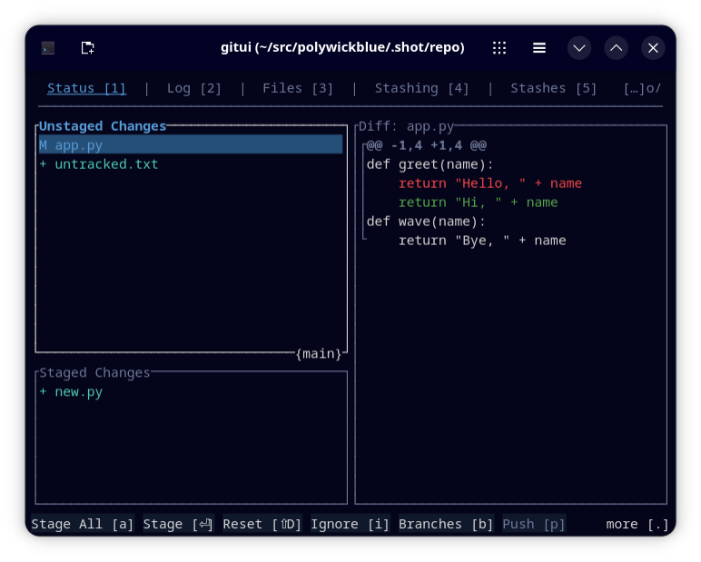

# Deepwick for gitui

Deepwick colors for [gitui](https://github.com/gitui-org/gitui).

> Deepwick is an unofficial theme derived from
> [Polywick Blue](https://vscode.polywickstudio.net) by Polywick Studio (MIT).
> Not affiliated with Polywick Studio.



## Install

gitui loads `theme.ron` from its config directory automatically:

```sh
mkdir -p "${XDG_CONFIG_HOME:-$HOME/.config}/gitui"
cp deepwick.ron "${XDG_CONFIG_HOME:-$HOME/.config}/gitui/theme.ron"
```

Or keep the name and pick it per run: copy it as `deepwick.ron` into the same
directory and start `gitui -t deepwick.ron`.

## Notes

- gitui ignores the whole file if any entry is malformed. To check, run
  `gitui --logfile /tmp/gitui.log` and look for `theme error`.
- `use_selection_fg` is off, so the selected row keeps its commit colors on
  the Selection background.
- New and untracked files Teal, modified Blue, removed Red, moved Magenta;
  hashes Gold, authors Light Blue, times Comment, tags Magenta, branches Teal.
- Bold and italic are fixed by gitui and cannot be themed.

Tested with gitui 0.28.1.

## License

MIT. See [LICENSE](LICENSE).
